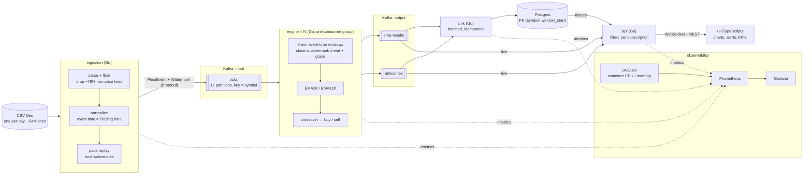

# Architecture

A pipeline of Go services connected by Kafka. How the engine computes results is in [windowing.md](windowing.md); why it is built this way is in [decisions.md](decisions.md).

## Overview



## Technology

| Concern | Choice | Notes |
|---|---|---|
| Backend language | Go | One module, several binaries, shared generated types |
| Message broker | Apache Kafka (KRaft mode, single node) | Redpanda speaks the same protocol, so it could replace Kafka without code changes |
| Kafka client | `franz-go` (`kgo`, `kadm`) | Pure Go; batching and LZ4 compression on the producer |
| Serialization | Protobuf, generated with `buf` | Go and TypeScript types from the same schema |
| Database | Postgres via `pgx` | Multi-row `INSERT … ON CONFLICT DO NOTHING` |
| Metrics | Prometheus client, Prometheus, Grafana, cAdvisor | |
| WebSocket | `coder/websocket` | |
| HTTP | Go standard library `net/http` | |
| UI | TypeScript, React, Vite | |
| Orchestration | Docker Compose | |

## The path of one price

1. **Ingestion** reads a CSV line. About 78% of lines are not price events and are dropped right here. A valid line becomes a small `PriceEvent`: symbol, security type, price and event time.
2. Ingestion sends the event to the Kafka topic `ticks`. The symbol decides the partition, so all events of one symbol stay in one ordered log. Each time event time has advanced by one second, ingestion also sends a **watermark** to every partition: "everything up to time T has been sent".
3. An **engine** instance reads that partition and puts the price into the symbol's current 5-minute window.
4. When a watermark shows that the window has ended (plus a 1 s grace period), the engine updates EMA38 and EMA100 with the window's last price, checks for a crossover and publishes an `EmaResult`, plus an `Advisory` if the averages crossed.
5. The **sink** writes results to Postgres for the history charts. The **API** pushes them live over WebSocket to every browser subscribed to that symbol.
6. The **ui** shows charts, alerts and performance numbers.

## Services

| Service | Job | State it keeps |
|---|---|---|
| **ingestion** | Read the CSVs in date order, parse and filter, pace the replay, send events and watermarks to `ticks` | Highest event time sent so far, pacing clock |
| **engine** (N instances) | Assign events to windows, close windows on watermarks, compute EMAs, detect crossovers | Per-symbol EMA state, owned by one goroutine per partition |
| **sink** | Read the result topics and write them to Postgres in batches | Kafka read position |
| **api** | Push live results over WebSocket, filtered per client subscription; serve history from Postgres | Connected clients and their subscriptions |
| **ui** | Symbol filter, price and EMA charts with crossover markers, advisory feed, KPIs | — |
| **Prometheus, Grafana, cAdvisor** | Collect metrics, show dashboards, measure container CPU and memory | Time series |

## Messages

All messages between services are Protobuf. The schemas are the source of truth:

- [`ticks.proto`](../proto/breakout/ticks/v1/ticks.proto): `PriceEvent` and `Watermark`, wrapped in `TickMessage`, on `ticks`.
- [`results.proto`](../proto/breakout/results/v1/results.proto): `EmaResult` on `ema-results` and `Advisory` on `advisories`.

`buf generate` writes the Go code to `gen/go/`; it is committed, so building needs no buf. The browser gets JSON.

## Kafka topics

| Topic | Partitions | Key | Content |
|---|---|---|---|
| `ticks` | 12 | symbol | `TickMessage`: price events and watermarks |
| `ema-results` | 1 | symbol | One `EmaResult` per symbol and window |
| `advisories` | 1 | symbol | `Advisory`, rare and latency-critical |

- Ingestion picks the partition itself: `hash(symbol) % 12`, so a symbol's events stay in one ordered partition. Watermarks go to every partition.
- Each partition is read by one engine instance; inside it, one goroutine owns the partition and its symbols' state, so no locks are needed.
- The partition count must not change while data flows: it would move symbols to other partitions.

## Storage

Postgres holds the history for the charts. Only the sink writes to it. [`deploy/postgres/init.sql`](../deploy/postgres/init.sql) creates the tables `ema_results` and `advisories`, both keyed by `(symbol, window_start_ms)`.

- The sink writes each batch with one multi-row `INSERT … ON CONFLICT DO NOTHING`.
- Only after that insert succeeds does the sink commit its offset (its read position) to Kafka, which stores it per consumer group. After a crash, the sink resumes from the last committed offset and writes the uncommitted batch again; the primary key makes the repeated rows no-ops.

## Deployment

Everything runs on one machine with Docker Compose ([`deploy/docker-compose.yml`](../deploy/docker-compose.yml)).

| Container | Image | Host port | Role |
|---|---|---|---|
| `kafka` | `apache/kafka` | 9094 | Single broker in KRaft mode; containers reach it at `kafka:9092` |
| `kafka-init` | `apache/kafka` | — | Creates the three topics, then exits |
| `postgres` | `postgres` | 5432 | Result history; tables from `init.sql` |
| `prometheus` | `prom/prometheus` | 9090 | Scrapes cAdvisor, later every service's `/metrics` |
| `grafana` | `grafana/grafana` | 3000 | Dashboards, Prometheus preconfigured, no login |
| `cadvisor` | `ghcr.io/google/cadvisor` | — | CPU and memory per container |
| `ingestion` | built from `Dockerfile` | — | Replays the files in `data/`, mounted read-only; started only by `up ingestion` |

The root `Dockerfile` builds any service in `cmd/` (`--build-arg SERVICE=…`) into a small static image.

## Configuration

Services read environment variables; the defaults suit running on the host, and Compose sets the values for inside it.

| Variable | Default | Used by | Meaning |
|---|---|---|---|
| `KAFKA_BROKERS` | `localhost:9094` | all | Comma-separated seed brokers; `kafka:9092` inside Compose |
| `METRICS_ADDR` | `:2112` | all | Address of `/metrics` |
| `REPLAY_SPEED` | `0` | ingestion | Event-time seconds per wall-clock second; `0` = as fast as possible |

Ingestion takes the day files as arguments, in date order. At a set speed, pacing starts at the first event; quiet periods such as nights replay at that speed too. After the last file, ingestion keeps serving `/metrics` until stopped, so the final counts can be scraped.

Topic auto-creation is off, so a typo in a topic name fails loudly instead of creating a new topic.

## Repository layout

```
breakout/
├── README.md, go.mod, buf.yaml, buf.gen.yaml, Dockerfile
├── docs/                    # this documentation
├── proto/                   # Protobuf schemas (done)
├── gen/go/                  # generated code, never edited by hand (done)
├── cmd/
│   └── ingestion/           # CSV files → ticks (done)
├── internal/
│   ├── csvparse/            # CSV line → price event (done)
│   ├── engine/              # windows, EMAs and crossovers, without Kafka (done)
│   └── stream/              # topic names, partition function, Kafka client (done)
├── tools/
│   ├── datacheck/{grace,order,windows}/   # data checks behind the constants (done)
│   └── enginecheck/         # runs day files through the engine core (done)
├── deploy/                  # Compose file, Postgres, Prometheus and Grafana config (infrastructure done)
├── report/                  # Typst report
├── data/                    # the CSV files, ignored by git
│
│   planned:
├── cmd/{engine,sink,api}/            # one folder per service binary
├── internal/{store,metrics}/
├── tools/experiments/
└── ui/                      # web UI
```
