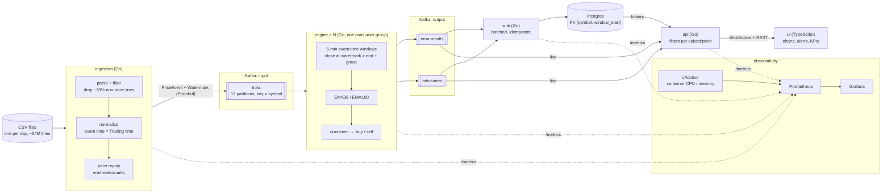

# Architecture

A pipeline of Go services connected by Kafka. How the engine computes results is in [windowing.md](windowing.md); why it is built this way is in [decisions.md](decisions.md).

## Overview



## Technology

| Concern | Choice | Notes |
|---|---|---|
| Backend language | Go | One module, several binaries, shared generated types |
| Message broker | Apache Kafka (KRaft mode, single node) | Redpanda speaks the same protocol, so it could replace Kafka without code changes |
| Kafka client | `franz-go` (`kgo`, `kadm`) | Pure Go; batching and LZ4 compression on the producer |
| Serialization | Protobuf, generated with `buf` | Go and TypeScript types from the same schema |
| Database | Postgres via `pgx` | Multi-row `INSERT … ON CONFLICT DO NOTHING` |
| Metrics | Prometheus client, Prometheus, Grafana, cAdvisor | |
| WebSocket | `coder/websocket` | |
| HTTP | Go standard library `net/http` | |
| UI | TypeScript | Framework not chosen yet |
| Orchestration | Docker Compose | |

## The path of one price

1. **Ingestion** reads a CSV line. About 78% of lines are not price events and are dropped right here. A valid line becomes a small `PriceEvent`: symbol, security type, price and event time.
2. Ingestion sends the event to the Kafka topic `ticks`. The symbol decides the partition, so all events of one symbol stay in one ordered log. Each time event time has advanced by one second, ingestion also sends a **watermark** to every partition: "everything up to time T has been sent".
3. An **engine** instance reads that partition and puts the price into the symbol's current 5-minute window.
4. When a watermark shows that the window has ended (plus a 1 s grace period), the engine updates EMA38 and EMA100 with the window's last price, checks for a crossover and publishes an `EmaResult`, plus an `Advisory` if the averages crossed.
5. The **sink** writes results to Postgres for the history charts. The **API** pushes them live over WebSocket to every browser subscribed to that symbol.
6. The **ui** shows charts, alerts and performance numbers.

## Services

| Service | Job | State it keeps |
|---|---|---|
| **ingestion** | Read the CSVs in date order, parse and filter, pace the replay, send events and watermarks to `ticks` | Highest event time sent so far, pacing clock |
| **engine** (N instances) | Assign events to windows, close windows on watermarks, compute EMAs, detect crossovers | Per-symbol EMA state, owned by one goroutine per partition |
| **sink** | Read the result topics and write them to Postgres in batches | Kafka read position |
| **api** | Push live results over WebSocket, filtered per client subscription; serve history from Postgres | Connected clients and their subscriptions |
| **ui** | Symbol filter, price and EMA charts with crossover markers, advisory feed, KPIs | — |
| **Prometheus, Grafana, cAdvisor** | Collect metrics, show dashboards, measure container CPU and memory | Time series |

## Messages

All messages between services are Protobuf, defined in `proto/`. The browser gets JSON.

```proto
// proto/ticks/v1/ticks.proto — what ingestion sends to the engine
enum SecType { SEC_TYPE_UNSPECIFIED = 0; EQUITY = 1; INDEX = 2; }

message PriceEvent {
  string  symbol         = 1; // "RDSA.NL", exchange included
  SecType sec_type       = 2;
  double  price          = 3; // the Last column
  int64   event_time_ms  = 4; // Date + Trading time as epoch ms
  int64   ingest_time_ns = 5; // wall clock when sent, for latency
}

message Watermark {
  int64  event_time_ms  = 1; // highest event time sent so far
  int64  ingest_time_ns = 2; // wall clock when sent, for latency
  uint32 source_id      = 3; // which producer; the engine uses the minimum over producers
}

message TickMessage { oneof payload { PriceEvent price = 1; Watermark watermark = 2; } }
```

```proto
// proto/results/v1/results.proto — what the engine publishes
message EmaResult {
  string symbol                      = 1;
  int64  window_start_ms             = 2;
  double last_price                  = 3;
  double ema38                       = 4;
  double ema100                      = 5;
  int64  closing_watermark_ingest_ns = 6; // for window-result latency
  int64  published_ns                = 7;
}

enum Side { SIDE_UNSPECIFIED = 0; BUY = 1; SELL = 2; }

message Advisory {
  string symbol                      = 1;
  int64  window_start_ms             = 2;
  Side   side                        = 3;
  double ema38                       = 4;
  double ema100                      = 5;
  bool   warmup                      = 6; // true for the artificial first-window advisory, see windowing.md
  int64  closing_watermark_ingest_ns = 7;
  int64  published_ns                = 8;
}
```


## Kafka topics

| Topic | Partitions | Key | Content |
|---|---|---|---|
| `ticks` | 12 | symbol | `TickMessage`: price events and watermarks |
| `ema-results` | 1 | symbol | One `EmaResult` per symbol and window |
| `advisories` | 1 | symbol | `Advisory`, rare and latency-critical |

- Ingestion picks the partition itself: `hash(symbol) % 12`, so a symbol's events stay in one ordered partition. Watermarks go to every partition.
- Each partition is read by one engine instance; inside it, one goroutine owns the partition and its symbols' state, so no locks are needed.
- The partition count must not change while data flows: it would move symbols to other partitions.

## Storage

Postgres holds the history for the charts. Only the sink writes to it.

```sql
CREATE TABLE ema_results (
    symbol          text             NOT NULL,
    window_start_ms bigint           NOT NULL,
    last_price      double precision NOT NULL,
    ema38           double precision NOT NULL,
    ema100          double precision NOT NULL,
    PRIMARY KEY (symbol, window_start_ms)
);

CREATE TABLE advisories (
    symbol          text             NOT NULL,
    window_start_ms bigint           NOT NULL,
    side            smallint         NOT NULL, -- 1 = buy, 2 = sell
    ema38           double precision NOT NULL,
    ema100          double precision NOT NULL,
    warmup          boolean          NOT NULL,
    PRIMARY KEY (symbol, window_start_ms)
);
```

- The sink writes each batch with one multi-row `INSERT … ON CONFLICT DO NOTHING`.
- Only after that insert succeeds does the sink commit its offset (its read position) to Kafka, which stores it per consumer group. After a crash, the sink resumes from the last committed offset and writes the uncommitted batch again; the primary key makes the repeated rows no-ops.

## Repository layout

```
breakout/
├── README.md, go.mod
├── docs/                    # this documentation
├── internal/
│   └── csvparse/            # CSV line → price event (done)
├── tools/
│   └── datacheck/{grace,order,windows}/   # data checks behind the constants (done)
├── data/                    # the CSV files, ignored by git
│
│   planned:
├── proto/                   # Protobuf schemas
├── gen/go/                  # generated code, never edited by hand
├── cmd/{ingestion,engine,sink,api}/   # one folder per service binary
├── internal/{replay,window,indicator,stream,store,metrics,config}/
├── tools/experiments/
├── ui/                      # web UI
└── deploy/                  # Dockerfile, docker-compose.yml, Prometheus and Grafana config
```

`indicator` and `window` do not import Kafka or Postgres code, so they are tested without infrastructure.
